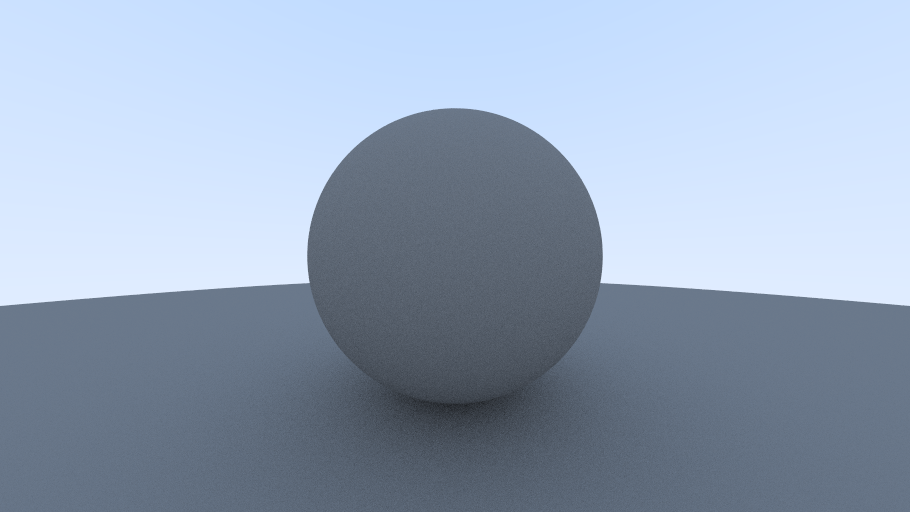
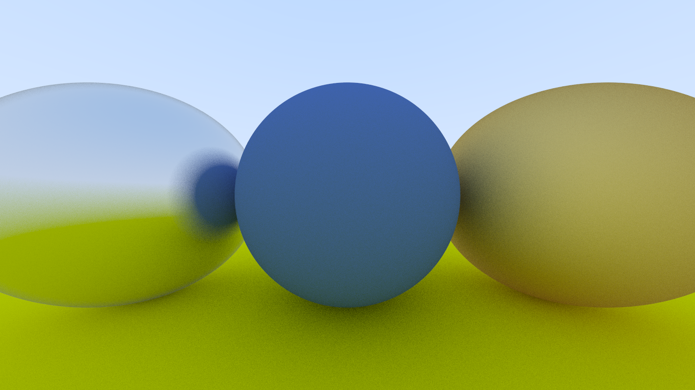
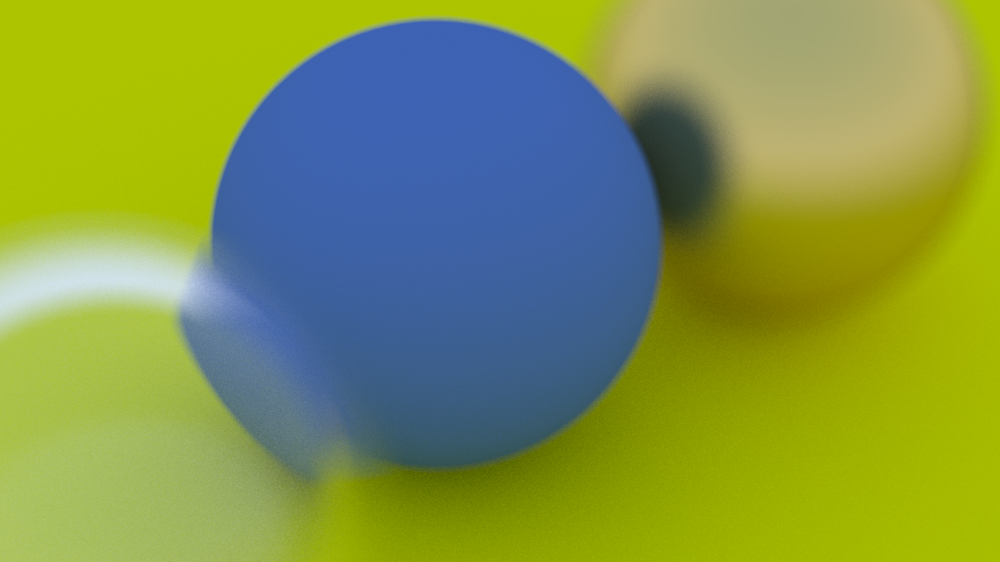

<h1 align="center">Ray Tracing in One Weekend</h1>

<p align="center">C++로 만든 CPU 레이 트레이서</p>

<p align="center">
  
  
  
</p>

<p align="center"></p>

## Contents

- [프로젝트 소개](#프로젝트-소개)
- [광선 추적과 픽셀 샘플링](#광선-추적과-픽셀-샘플링)
- [재질과 디포커스 블러](#재질과-디포커스-블러)
- [OpenMP 병렬 렌더링](#openmp-병렬-렌더링)
- [빌드 및 실행](#빌드-및-실행)

## 프로젝트 소개

[Ray Tracing in One Weekend](https://raytracing.github.io/books/RayTracingInOneWeekend.html)를 따라, 카메라에서 보낸 광선이 구에 닿아 재질에 따라 반사·굴절하는 과정을 C++로 구현한 CPU 레이 트레이서입니다.

- 확산, 금속, 유리 재질과 디포커스 블러를 구현했습니다.
- 교차 판정(`IHittable`)과 재질(`Material`)을 인터페이스로 분리해, 새 재질을 추가해도 광선 추적 코드는 바뀌지 않습니다.
- OpenMP로 행 단위 병렬 렌더링을 하고, 난수 생성기를 스레드마다 따로 둬 잠금 없이 샘플링합니다.

위 최종 장면은 1920×1080, 픽셀당 500샘플, 최대 추적 깊이 50으로 렌더링했습니다. 작은 구의 재질은 확산 80%, 금속 15%, 유리 5%의 확률로 고르고, 큰 구 세 개에는 각 재질을 하나씩 적용했습니다.

## 광선 추적과 픽셀 샘플링

1. 샘플을 여러 개 쓸 때는 픽셀 내부의 임의 위치를 뽑아 카메라 광선을 만듭니다. 한 픽셀에 걸친 여러 지점을 샘플링하면 물체 가장자리의 계단 현상이 줄어듭니다.
2. 각 광선이 만나는 가장 가까운 표면을 찾습니다. 표면에 닿으면 재질이 돌려준 반사·굴절 광선을 다시 추적하고, 다음 광선에서 얻은 색에 재질의 감쇠 색을 곱합니다. 광선이 장면을 벗어나면 방향에 따른 하늘색을 사용합니다.
3. 샘플 색을 평균해 무작위 산란에서 생기는 잡음을 줄입니다. 평균 색에 감마 보정을 적용해 이미지 버퍼에 기록하고, 렌더링이 끝나면 PNG로 저장합니다.

교차 판정과 재질 처리는 인터페이스로 나눴습니다. 구와 물체 목록은 모두 `IHittable`을 구현합니다. 목록은 더 가까운 교차를 찾을 때마다 탐색 거리의 상한을 줄이고, 마지막에 남은 교차점과 법선, 앞뒷면, 재질을 `HitRecord`에 돌려줍니다. 카메라는 재질이 무엇인지 모른 채 `Scatter()`만 호출해 다음 광선과 감쇠 색을 얻습니다.

```cpp
if (record.pMaterial->Scatter(_ray, record, attenuation, scattered))
{
    return attenuation * RayColor_(scattered, _depth + 1, _world);
}
return Vec3::kZero;
```

새 재질은 `Material`을 상속해 `Scatter()`만 구현하면 되고, 카메라의 광선 추적 코드는 그대로입니다. [카메라](RayTracingInOneWeekend/Camera.cpp) · [교차 판정](RayTracingInOneWeekend/HittableList.cpp)

## 재질과 디포커스 블러

| 재질 | 광선을 처리하는 방식 |
| --- | --- |
| 확산 (`Lambertian`) | 표면 법선 쪽 반구로 광선을 흩뿌려 부드러운 명암을 만듭니다. |
| 금속 (`Metal`) | 거울 반사 방향에 거칠기(`fuzz`)에 따른 흔들림을 더합니다. |
| 유리 (`Dielectric`) | Schlick 근사로 계산한 반사율에 따라 반사와 굴절을 고릅니다. 전반사 조건에서는 반사합니다. |

<p align="center">
  
  
</p>

디포커스 블러는 광선의 시작점을 렌즈 원판 위에서 바꾸고, 광선이 초점면의 픽셀 샘플 위치를 향하게 해서 구현했습니다. 아래 왼쪽은 유리·확산·금속 재질을 함께 그린 장면이고, 오른쪽은 초점면에서 벗어난 구의 윤곽이 흐려진 결과입니다.

<p align="center">
  
  
</p>

## OpenMP 병렬 렌더링

픽셀을 독립적으로 계산할 수 있어 화면을 행 단위로 나눴습니다. 하늘을 향한 광선은 빠르게 끝나고, 구가 겹쳐 보이는 곳에서는 반사와 굴절이 이어집니다. OpenMP의 `schedule(dynamic)`을 사용해 먼저 끝난 스레드가 다음 행을 가져가도록 했습니다. 픽셀 위치, 산란 방향, 렌즈 위치에 쓰는 SHR3 난수 생성기는 `thread_local`로 두어 스레드마다 상태를 따로 관리합니다. [난수 생성기 설정](RayTracingInOneWeekend/RandomUtils.cpp)

## 빌드 및 실행

Windows x64에서 Visual Studio 2026의 C++ 데스크톱 개발 워크로드와 플랫폼 도구 집합 `v145`를 사용합니다.

1. 저장소를 받습니다.

   ```powershell
   git clone https://github.com/JuggernautSensei/RayTracingInOneWeekend.git
   ```

2. `RayTracingInOneWeekend.sln`을 열고 `Release | x64` 구성을 선택합니다.
3. PNG 저장에 쓰는 헤더를 내려받고, 헤더가 있는 폴더를 프로젝트 속성의 "C/C++ → 일반 → 추가 포함 디렉터리"에 등록합니다. [stb_image_write.h](https://github.com/nothings/stb/blob/master/stb_image_write.h)
4. 빌드한 뒤 실행합니다. 콘솔에 진행률이 표시되며, 완료되면 작업 디렉터리의 `Outputs`에 장면 이름과 시각이 붙은 PNG가 저장됩니다.

해상도, 샘플 수, 최대 추적 깊이, 카메라 위치와 초점 거리는 실행 진입점에서 바꿀 수 있습니다. [Main.cpp](RayTracingInOneWeekend/Main.cpp)
