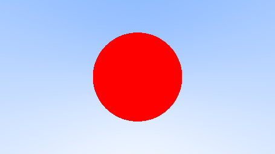
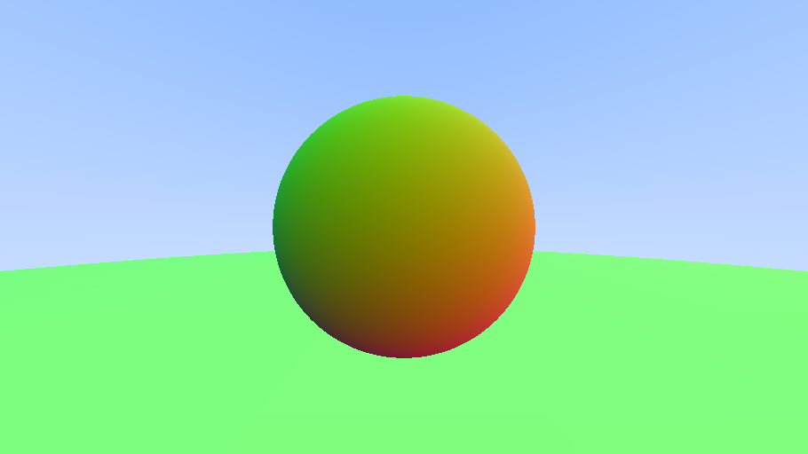
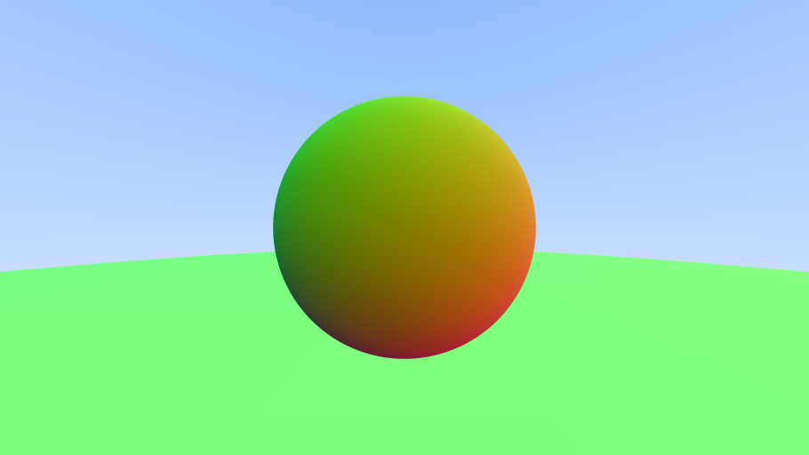
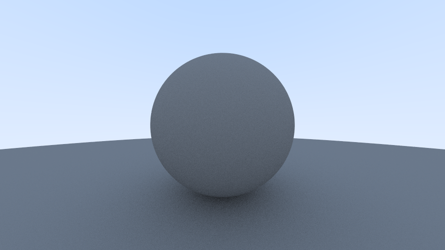
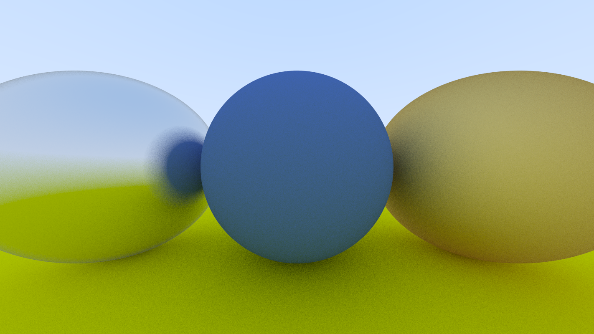
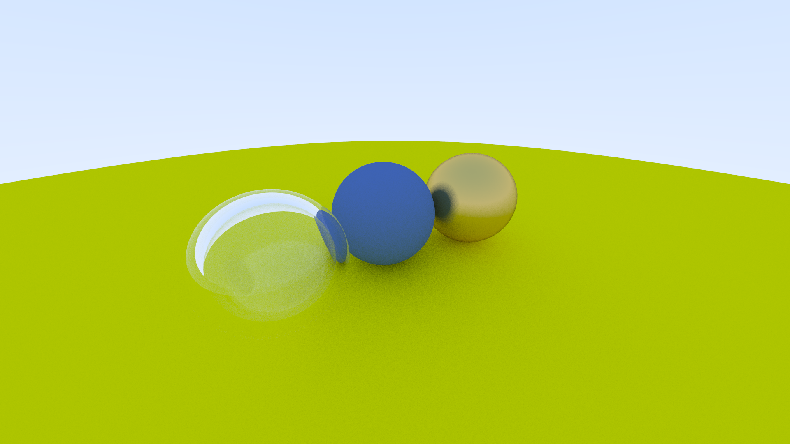
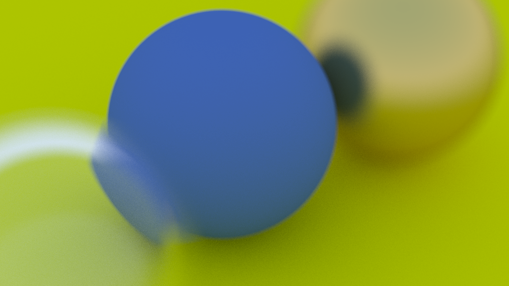

<div align="center">

# Ray Tracing in One Weekend

<p align="center"></p>

</div>

[Ray Tracing in One Weekend](https://raytracing.github.io/books/RayTracingInOneWeekend.html)의 내용을 바탕으로 구현한 C++ 소프트웨어 레이 트레이서입니다. 카메라에서 픽셀을 향해 광선을 보내고, 물체와의 교차와 재질에 따른 반사·굴절을 계산해 한 장의 이미지를 만듭니다. 렌더링은 CPU에서 수행하며 결과는 PNG로 저장합니다.

광선 방향으로 하늘을 그리는 것에서 시작해 구와의 교차, 표면 법선, 안티에일리어싱을 구현했습니다. 여기에 확산·금속·유리 재질을 더하고, 카메라의 위치와 시야각, 초점을 조절해 여러 재질의 구가 놓인 장면을 구성했습니다.

## Contents

- [광선과 배경](#광선과-배경)
- [구와 표면 법선](#구와-표면-법선)
- [샘플링](#샘플링)
- [확산 반사](#확산-반사)
- [금속과 유리](#금속과-유리)
- [카메라와 초점](#카메라와-초점)
- [최종 씬](#최종-씬)

<br>

## 광선과 배경

카메라 앞에 가상의 화면인 뷰포트를 놓고, 각 픽셀의 위치를 향하는 광선을 만들었습니다. 광선은 시작점과 방향으로 표현합니다. 시작점에 방향 벡터의 `t`배를 더하면 광선 위의 점을 구할 수 있고, 이 점이 물체의 표면에 놓이는지를 검사해 픽셀의 색을 정합니다. 방향 벡터는 단위 길이로 정규화해 사용했습니다.

처음에는 물체 없이 광선의 방향만으로 배경을 그렸습니다. 방향의 y 성분을 0~1 범위로 옮겨 흰색과 하늘색을 보간하면, 위쪽을 향할수록 푸르고 아래쪽을 향할수록 밝은 하늘이 됩니다. 물체를 추가한 뒤에도 어디에도 닿지 않은 광선은 이 배경색을 반환합니다.

<p align="center"></p>

<p align="center"><em>광선의 세로 방향을 두 색 사이의 보간값으로 사용한 배경입니다.</em></p>

<br>

## 구와 표면 법선

### 구 교차

구는 중심과 반지름으로 정의했습니다. 광선 위의 점과 구 중심 사이의 거리가 반지름과 같아지는 조건을 정리하면 `t`에 대한 이차방정식이 됩니다. 판별식이 음수이면 광선이 구를 지나지 않고, 근이 있으면 구의 표면과 만나는 위치를 얻을 수 있습니다.

교차 검사는 가까운 근부터 수행합니다. 가까운 근이 허용된 거리 범위 밖이면 먼 근을 확인하고, 유효한 근을 찾으면 그 위치를 교차 결과에 기록합니다. 이 단계에서는 구에 닿은 픽셀을 빨간색으로 칠해 교차 여부를 확인했습니다.

### 법선과 앞뒷면

구의 형태에 따라 색이 달라지게 하려면 표면이 향하는 방향을 알아야 합니다. 교차 지점에서 구 중심을 뺀 벡터를 정규화하면, 표면에 수직이며 바깥쪽을 향하는 단위 법선을 구할 수 있습니다. 법선의 세 성분을 RGB에 대응시켜 표면 방향을 색으로 표현했습니다. 바닥에는 반지름이 큰 구를 사용했습니다.

<p align="center">
  
  
</p>

<p align="center"><em>왼쪽은 교차 여부만 표시한 구이고, 오른쪽은 법선 방향을 색으로 나타낸 구와 바닥입니다.</em></p>

표면에 도착한 광선이 구 바깥에서 들어온 것인지, 안쪽에서 나가는 것인지도 구분했습니다. 광선 방향과 바깥쪽 법선의 내적이 양수이면 안쪽에서 나온 경우입니다. 이때 법선을 뒤집어 입사 광선과 마주 보게 하고, `bFrontFace`에 앞뒷면 정보를 따로 남겼습니다. 이후 유리 재질에서 공기와 유리 사이의 굴절률 비율을 선택할 때 이 정보를 사용합니다.

### 가장 가까운 교차

물체가 여러 개이면 한 광선이 여러 표면을 통과할 수 있습니다. 이 가운데 가장 가까운 표면만 보이도록, 교차를 찾을 때마다 다음 탐색의 최대 거리를 줄였습니다.

```cpp
if (pHittable->Hit(_ray, _interval, _outRecord))
{
    bAnyHit       = true;
    _interval.max = _outRecord.t;   // 지금 찾은 표면보다 가까운 교차만 남깁니다.
}
```

모든 물체를 검사한 뒤에는 가장 작은 `t`를 가진 교차가 남습니다. 구를 목록에 넣는 순서와 관계없이 앞의 구가 뒤의 구를 가리게 되고, 교차한 표면의 위치·법선·재질을 다음 색 계산에 사용할 수 있습니다.

<br>

## 샘플링

픽셀마다 중앙을 향하는 광선을 하나씩 보내면 구의 경계가 계단처럼 보입니다. 경계에 걸친 픽셀도 구와 배경 중 한쪽 색만 갖기 때문입니다. 픽셀 안의 여러 위치를 살펴보고 그 색을 섞으면, 한 픽셀이 덮는 영역에 물체가 얼마나 포함되어 있는지를 표현할 수 있습니다.

광선을 만들 때 픽셀 내부의 위치를 무작위로 바꾸고, 얻은 색을 평균내는 방식으로 안티에일리어싱을 적용했습니다. 샘플이 하나일 때는 중앙을 사용하고, 여러 개일 때는 매번 다른 위치를 선택합니다.

```cpp
const float xOffset = m_sample == 1 ? 0.5f : GenerateRandomSHR3<float>(0.f, 1.f);
const float yOffset = m_sample == 1 ? 0.5f : GenerateRandomSHR3<float>(0.f, 1.f);
```

<p align="center"></p>

<p align="center"><em>구와 배경 사이의 픽셀에 두 색이 함께 반영되면서 외곽선이 부드러워집니다.</em></p>

같은 평균 계산은 재질과 초점 표현에도 이어집니다. 확산 반사에서는 광선이 퍼지는 방향을, 디포커스 블러에서는 렌즈 위의 시작점을 무작위로 선택합니다. 샘플 수를 늘리면 이러한 무작위 선택에 따른 잡음이 줄어들지만, 픽셀마다 추적해야 하는 광선 수와 계산량도 함께 늘어납니다.

<br>

## 확산 반사

### 산란과 색 누적

법선을 색으로 표시하던 단계에서 표면의 색과 음영을 계산하는 단계로 확장했습니다. 확산 재질은 광선이 표면에 닿았을 때 여러 방향으로 퍼져 나가는 표면입니다. 이 가운데 한 방향을 선택해 새 광선을 보내고, 그 광선이 만나는 다음 표면이나 배경의 색을 계산했습니다.

산란 방향은 법선에 구면 위의 무작위 단위 벡터를 더해 만들었습니다. 정규화한 결과는 표면 바깥쪽 반구를 향하며, 법선에 가까운 방향이 더 자주 선택됩니다. 두 벡터가 상쇄되어 길이가 거의 0이 되는 경우에는 법선 방향을 사용했습니다.

재질은 산란 방향과 함께 감쇠 색인 `albedo`를 반환합니다. 다음 광선에서 얻은 색에 이 값을 성분별로 곱하면 표면의 색이 반영됩니다. 파란 재질은 빨강과 초록 성분을 상대적으로 줄이고, 회색 재질은 각 성분을 같은 비율로 줄이는 식입니다.

```cpp
if (record.pMaterial->Scatter(_ray, record, attenuation, scattered))
{
    return attenuation * RayColor_(scattered, _depth + 1, _world);
}
return Vec3::kZero;
```

색 계산은 산란한 광선에 대해 같은 함수를 다시 호출하는 재귀 구조입니다. 광선이 다른 물체에 닿으면 그 재질의 색이 다시 곱해지고, 배경에 도달하면 하늘색이 돌아옵니다. 경로를 따라 쌓인 표면의 감쇠가 처음 픽셀까지 전달되며, 여러 경로의 결과를 평균내 최종 색을 구합니다.

<p align="center"></p>

<p align="center"><em>구와 바닥에 확산 재질을 적용한 결과입니다. 표면의 밝기가 달라지고, 구 아래쪽과 바닥이 만나는 부분에는 어두운 음영이 나타납니다.</em></p>

물체와 바닥이 가까운 부분에서는 산란한 광선이 다른 표면에 다시 닿기 쉽습니다. 그만큼 감쇠를 여러 번 거친 경로가 생기므로, 배경으로 곧바로 향하는 부분과 밝기가 달라집니다. 위 이미지의 입자 형태 잡음은 무작위로 고른 경로들의 차이이며, 샘플을 더 모아 평균내면 줄어듭니다.

### 자기 교차와 감마 보정

산란 광선은 표면의 교차 지점에서 출발합니다. 부동소수점 오차로 방금 떠난 표면에 다시 닿은 것으로 판정되지 않도록, 다음 교차는 `t`가 `0.001`보다 큰 범위에서 검사했습니다. 물체 사이를 오가는 광선의 계산을 끝내기 위해 재귀 깊이에도 제한을 두었습니다.

광선 경로에서 더하고 곱하는 색은 선형 값입니다. 모든 샘플을 더한 뒤 샘플 수로 나누고, 감마 2의 보정을 적용해 이미지 버퍼에 기록했습니다.

```cpp
color /= static_cast<float>(m_sample);
m_imageBuffer.WriteLinear(x, y, GammaCorrect(color, 2.f));
```

감마 2 보정은 각 색 성분의 제곱근을 구하는 것과 같습니다. 평균낸 선형 색을 그대로 저장하면 중간 밝기가 어둡게 보이기 때문에, 표시할 색으로 변환한 뒤 RGB 바이트로 옮겼습니다.

<br>

## 금속과 유리

### 금속 반사

매끄러운 금속은 입사 방향과 표면 법선으로 반사 방향을 정합니다. 입사 벡터에서 법선 방향 성분의 두 배를 빼면 표면을 기준으로 대칭인 방향을 얻을 수 있습니다. 이 방향으로 새 광선을 추적해, 금속 표면에 비치는 다른 물체와 배경을 표현했습니다.

표면의 거칠기는 반사 방향에 무작위 벡터를 더하는 방식으로 조절했습니다. `fuzz`가 0이면 정해진 반사 방향을 그대로 사용하고, 값이 커질수록 방향이 넓게 퍼집니다. 여러 샘플을 평균내면 반사상이 흐려져 거친 금속처럼 보입니다.

```cpp
const Vec3 reflected = (_ray.dir.Reflect(_record.normal)
    + GenerateRandomUnitVecOnSphere() * m_fuzz).Normalize();
_scattered   = { _record.point, reflected };
_attenuation = m_albedo;
return reflected.Dot(_record.normal) > 0.f;
```

무작위 성분을 더한 결과가 표면 안쪽을 향하면 해당 경로는 흡수한 것으로 처리했습니다. 표면 바깥으로 향하는 광선에 대해서는 금속의 `albedo`를 곱해 다음 색을 누적합니다.

<p align="center"></p>

<p align="center"><em>가운데는 확산 재질, 양옆은 금속 재질입니다. 금속 구의 표면에는 바닥과 다른 구의 모습이 비칩니다.</em></p>

### 반사와 굴절

유리는 표면에서 반사되는 광선과 내부로 꺾여 들어가는 광선을 함께 다룹니다. 공기에서 유리로 들어갈 때와 유리에서 공기로 나올 때의 굴절률 비율이 다르므로, 앞뒷면 정보로 두 경우를 구분했습니다. 굴절 방향은 입사 방향과 법선, 두 매질의 굴절률 비율로 계산합니다.

유리 안에서 밖으로 나가는 광선은 입사각에 따라 굴절이 불가능할 수 있습니다. 이 전반사 조건에서는 반사 방향을 선택합니다. 굴절할 수 있는 경우에는 Schlick 근사로 반사율을 구하고, 난수와 비교해 반사와 굴절 중 하나를 선택했습니다.

```cpp
const float eta = _record.bFrontFace ? (1.f / m_ior) : m_ior;
const float cos = -_ray.dir.Dot(_record.normal);
const float sin = ::sqrtf(1.f - cos * cos);

if (eta * sin > 1.f || Reflectance(cos, eta) > GenerateRandomSHR3<float>(0.f, 1.f))
{
    dir = _ray.dir.Reflect(_record.normal).Normalize();
}
else
{
    dir = _ray.dir.Refract(_record.normal, eta).Normalize();
}
```

한 샘플에서는 한 경로만 추적하지만, 여러 샘플이 모이면 반사와 굴절이 반사율에 따라 함께 나타납니다. 표면을 비스듬히 볼수록 반사되는 비중이 커지고, 구 뒤쪽의 물체는 굴절된 경로를 따라 보입니다. 유리의 감쇠 색은 흰색으로 두었습니다.

<p align="center"></p>

<p align="center"><em>왼쪽 유리 구 너머로 바닥과 뒤쪽 장면이 굴절되어 보입니다. 가운데 확산 구, 오른쪽 금속 구와 표면의 차이를 비교할 수 있습니다.</em></p>

<br>

## 카메라와 초점

### 위치와 시야각

카메라는 위치, 바라보는 지점, 위쪽 방향과 수직 시야각으로 설정했습니다. 바라보는 방향과 위쪽 벡터에서 화면의 가로·세로 기저를 구하고, 뷰포트를 이 좌표계에 놓았습니다. 카메라를 옮겨도 같은 계산으로 각 픽셀이 향할 월드 위치를 구할 수 있습니다.

시야각은 한 화면에 담는 범위를 결정합니다. 같은 위치에서 시야각을 줄이면 더 좁은 범위가 화면을 채우므로 물체가 크게 보입니다. 뷰포트 크기는 시야각과 초점 거리로 정하고, 이미지의 종횡비를 반영한 뒤 픽셀 간격을 계산했습니다.

### 디포커스 블러

모든 광선이 카메라 중심 한 점에서 출발하는 방식에 렌즈의 크기를 더했습니다. 카메라 위치에 렌즈를 나타내는 원판을 두고, 그 위의 무작위 위치에서 광선을 출발시켰습니다. 원판에서 뽑은 2차원 좌표를 카메라의 가로·세로 기저로 옮기면 광선의 시작점이 됩니다.

```cpp
const Vec3 sample = GenerateRandomVec3InDisk();
return m_center + m_defocusDiskRight * sample.x + m_defocusDiskUp * sample.y;
```

이 광선들이 향하는 뷰포트는 초점 거리에 놓입니다. 초점면의 한 샘플 위치를 향하는 광선은 렌즈의 서로 다른 곳에서 출발해도 그 위치에서 만나지만, 초점면 앞뒤에서는 서로 다른 지점을 통과합니다. 픽셀 안의 위치와 렌즈 위의 시작점을 바꿔 가며 평균내면, 초점이 맞는 부분은 선명하게 남고 다른 거리의 물체는 흐려집니다.

<p align="center"></p>

<p align="center"><em>초점에서 벗어난 물체의 윤곽이 흐려지는 디포커스 블러입니다.</em></p>

렌즈 반지름은 디포커스 각도와 초점 거리로 정했습니다. 같은 초점 거리에서 디포커스 각도가 커지면 광선의 시작점이 더 넓게 퍼져 흐림이 커집니다. 각도가 0일 때는 카메라 중심에서 광선을 출발시킵니다.

<br>

## 최종 씬

<p align="center"></p>

큰 바닥 구 위에 반지름 0.2인 작은 구를 배치하고, 확산·금속·유리 재질을 섞어 최종 장면을 구성했습니다. 22×22 격자 안에서 위치를 조금씩 무작위로 옮기고, 큰 구 주변의 일부 위치는 비워 두었습니다. 작은 구의 재질 선택 확률은 확산 80%, 금속 15%, 유리 5%로 두었습니다.

큰 구 세 개에는 각각 굴절률 1.5의 유리, 갈색 확산 재질, 거칠기가 0인 금속을 적용했습니다. 바닥은 회색 확산 재질입니다. 같은 구 형태에 서로 다른 산란 규칙을 적용해, 주변 장면을 비추는 금속과 뒤쪽을 투과해 보여 주는 유리, 부드러운 음영을 갖는 확산 표면을 한 장면에 담았습니다.

렌더 설정은 다음과 같습니다.

| 항목 | 설정 |
|---|---|
| 이미지 크기 | 1920×1080 |
| 픽셀당 샘플 수 | 500 |
| 재귀 깊이 설정값 | 50 |
| 수직 시야각 | 20° |
| 카메라 위치 | `(13, 2, -3)` |
| 바라보는 지점 | `(0, 0, 0)` |
| 디포커스 각도 | 0.6° |
| 초점 거리 | 10 |

카메라를 낮은 시점에 놓고 원점 쪽을 바라보게 해 가까운 구와 멀리 있는 구가 함께 보이도록 했습니다. 광선과 구의 교차에서 시작한 계산에 재질의 산란과 여러 번의 샘플링, 렌즈의 초점 표현을 더해 최종 장면을 렌더링했습니다.
